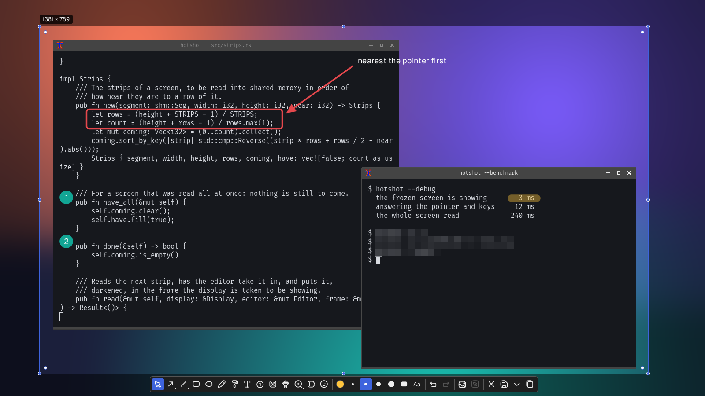
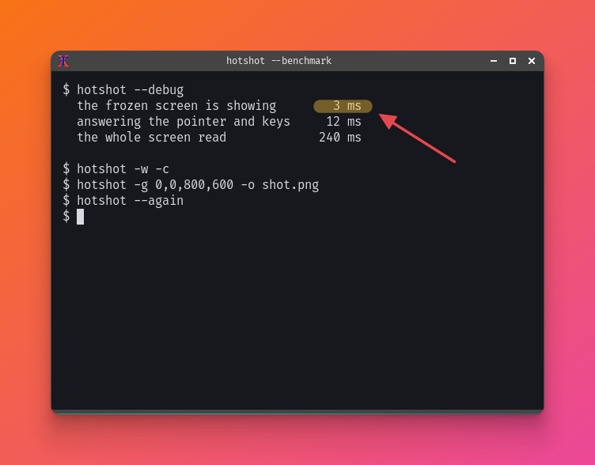
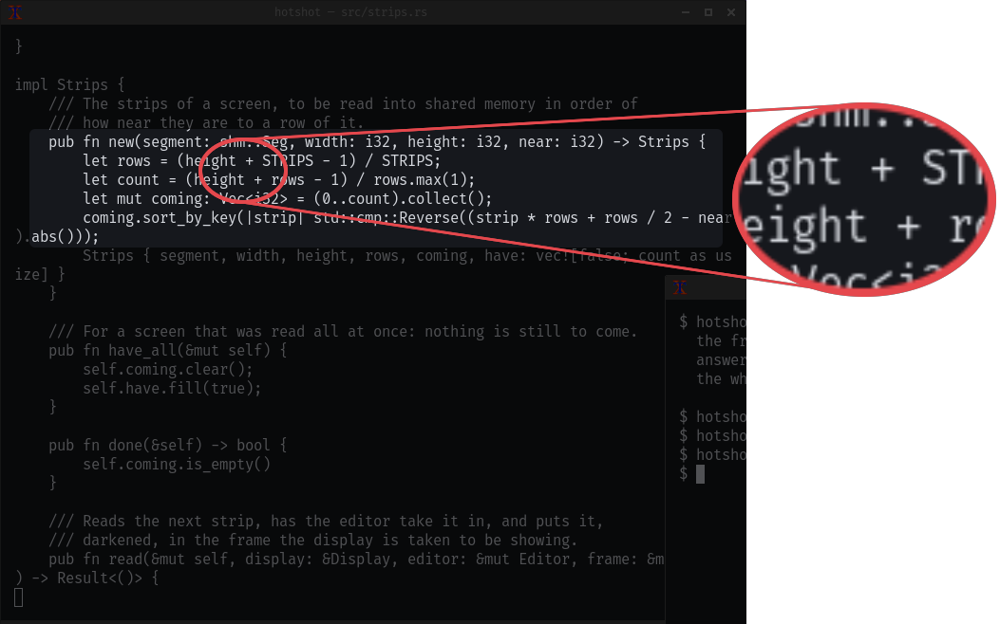
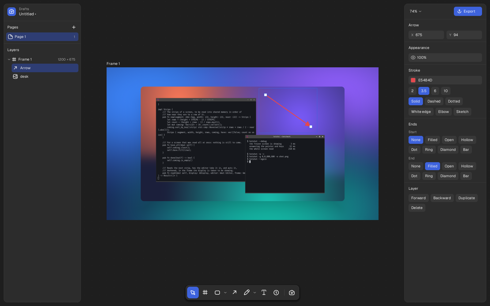

# hotshot

A fast screenshot tool for Linux. It is built for X11, and also works on
Wayland through the desktop's portal. Run it and the screen freezes: drag
out an area, draw on it if you like, then copy, save, pin or record it.
It is one small native program with no web view and no toolkit, and
nothing stays running in the background unless you ask for the tray icon.



## Install

```sh
cargo build --release
cp target/release/hotshot ~/.local/bin/
```

Then bind `hotshot` to a key (Print, for example) in your desktop's
keyboard settings. To add it to your application menu with its icon:

```sh
cp assets/hotshot.desktop ~/.local/share/applications/
cp assets/hotshot.svg ~/.local/share/icons/hicolor/scalable/apps/
```

## Use

```sh
hotshot                # freeze the screen and pick an area
hotshot -f             # capture the whole screen and save it immediately
hotshot -w -c          # copy the active window to the clipboard
hotshot -w --window-frame macos   # the active window, its own title bar swapped for a Mac's
hotshot -g 0,0,800,600 -o shot.png
hotshot --again        # capture the last screenshot again, with the same corners, frame and backdrop
hotshot --history      # list earlier screenshots and pick one to capture again
hotshot -a @2          # capture the one before last again; -a 4djc picks one by its name
hotshot --reopen       # reopen the last screenshot with its shapes still editable
hotshot -t calculator  # capture the window with "calculator" in its title
hotshot -D 3 --pointer # wait three seconds, and include the mouse pointer
hotshot --aspect 16:9  # lock the area to an aspect ratio; --fixed 1280x720 locks the size
hotshot -f -o shot.jxl # save as JPEG XL (or .avif, .webp, .jpg); --format sets the format for Save
hotshot --convert jxl ~/Pictures/*.png   # convert pictures, as jog does, each beside its original
hotshot --export design.hotshot --frame 2 --scale 2 --format avif   # a canvas frame, with no window
hotshot --fine-tune shot.png   # try each format's settings on a picture, side by side, then convert it
hotshot --pin          # pin the screenshot on screen, above other windows
hotshot --record       # record an area; run again to stop (needs ffmpeg)
hotshot --tray         # show an icon in the panel's tray; --menu opens its menu
```

Drag to select an area, click a window to select it, or press Enter for
the whole screen. Then:

| Key | |
|---|---|
| `Enter` | copy to the clipboard |
| `Ctrl+S` | save to `~/Pictures/Screenshots` |
| `Ctrl+E` | open it on the canvas, with its shapes still editable (or the # button at the end of the bar) |
| `Esc` | cancel |
| `Ctrl+Z` / `Ctrl+Shift+Z` | undo / redo |

The arrow beside Save lists where it saves to and, under Save as, what
kind of file it writes, PNG, JPEG XL or WebP lossless, JPEG XL, AVIF,
WebP or JPEG, each with what this picture comes to in it, tried for real
as the list opens; the kind chosen is kept for next time, as the folder
is. Fine-tune…, at its end, opens the picture in a window of its own to
try each kind's settings side by side, and converts it into the folder.

`hotshot --help` lists every option and key.

## Drawing

| Key | Tool |
|---|---|
| `V` | move and select |
| `A` `L` | arrow, line |
| `R` `O` | rectangle, oval |
| `P` `H` | pen, marker |
| `T` | text: five fonts, bold, italic, highlighted, bulleted, or on a colored background |
| `N` | numbered counters |
| `B` | blur |
| `S` | spotlight |
| `Z` | zoom lens |
| `J` `E` | the library: labels, status dots, key caps, tooltips, sticky notes, pins and the rest; and emoji, all searchable |
| `W` | frame: one of forty backdrops, with padding, a shadow, and a window round the picture (`1`-`8` while it is open): macOS, Windows 11, GNOME, KDE Plasma, Ubuntu, a browser, a terminal or none, light or dark as the picture is, with the title of the window you took in its bar; a window clicked loses its own title bar under it |
| `M` | show or hide the mouse pointer in the screenshot |
| `C` `I` | colors, color picker |
| `F` | fill a rectangle or oval, or not |
| `1`-`4` | line width and text size |

Shapes stay editable: select one and a small bar appears above it with
what you can change about it (color, width, font and text style) and
buttons to bring it forward or send it backward (Shift-click for all the
way), duplicate it or delete it. Rectangles and ovals have a border and
a fill, each in its own color or none. An arrow is made of parts: a head
at either end (filled, open, hollow, dot, ring, diamond, bar or none), a
straight or elbow path, and a solid, dashed or dotted line, with a white
edge for busy pictures. Boxes, ovals and arrows can be sketched, drawn
by hand. An arrow or line drawn from or onto a box, oval or text sticks
to it, as Figma's connectors do: put down well inside, it points at
the box and stops at its edge; put down at the edge, it stays at that
spot. It follows when the box moves, and lets go when its end is dragged
away or it is moved on its own. With
a tool in hand and nothing selected, the same bar sits above the main
one, for how the next shape is drawn. The keys work too: `Ctrl+D`
duplicates, and `Ctrl+]` and `Ctrl+[` move a shape above or below
another. A duplicate goes beside the shape, to its right or, with no
room there in the picture, below it; move it and duplicate again, and
the next goes as far from it again, as on the canvas. Drag the dot in
the middle of an arrow or line to bend it, and just outside a corner of
a shape to rotate it. A shape being moved snaps to the edges and middles
of the others and of the picture, with a guide where it does, and to
even gaps between shapes, marked in magenta; hold Ctrl not to snap. The
selection snaps to window edges. As in Figma, hold Shift to keep
proportions (or rotate in 15° steps) and Alt to draw or resize from the
center.





## Canvas

`hotshot --edit` opens your projects: folders of files in
`~/Pictures/hotshot`, with Recent, Drafts, and every capture taken in
capture mode, any of which starts a new file. `hotshot --edit FILE`
(or `--canvas`) opens a `.hotshot` file, or starts a file in Drafts with
the pictures given. Files are saved as you work, as Figma saves them.

In Captures, Ctrl or Shift click picks several (`Ctrl+A` all, Esc none),
and a right click converts them: Convert to ▸ lists the kinds, each
written beside its original with the new ending, a line along the
bottom counting them through, "Converting to AVIF · 9 of 14 · 38 MB →
11 MB", then what they came to with Undo, which takes away what was
written. The originals are kept, unless Replace originals is ticked:
then each goes to the library's trash once converted, and Undo brings
it back. Fine-tune… opens the Convert window on them, tried on the
first, to convert them all with the settings found.

A file has pages, listed down the left, and each page has frames: the
pictures you export, laid out side by side. `F`, or the frame tool,
drags out a new one; drag a frame by its name to move it, double-click
the name to rename it. A frame being moved snaps to the edges and
middles of the other frames and of the page's own layers, with a red
line across where it does, and to even gaps between them, marked in
magenta with how wide; hold Ctrl not to snap, and Shift to keep it to
across or down.

As in Figma, a shape drawn, a picture pasted or dropped, or a label put down outside
every frame is the page's own: drawn on the page, not cut off by a
frame, listed in the layers among the frames, picked out, moved, styled
and undone as a frame's layers are, kept in the file, and left out of
every export. Drag one onto a frame and let go, or drop its row on the
middle of the frame's row in the list, and it goes into that frame where
it was on the page; drag a frame's layer off every frame and it goes
onto the page.

The page's own layers and its frames are stacked in one order, as
Figma stacks what is on a page: drawn bottom to top, and clicked through
the same way, so a frame over a box hides it and takes the click. A new
frame or a new layer on the page goes on top of everything, a copy of a
frame just over it. The list of layers shows that order, the topmost
first; drag a frame's row, or one of the page's own layers, by the top
or bottom of another row to put it just over or under that. With a frame
picked out (click its name), or one of the page's own layers, Bring
forward, Send backward, to front and to back (`Ctrl+]`, `Ctrl+[`, with
Shift for all the way, or Order in its menu) move it among everything on
the page. The order is kept in the file; a file from before has its
frames under the page's own layers, as they were drawn then.

`Ctrl+D` duplicates as Figma does. A frame's first copy goes 100 to its
right, past any frame already there; a layer's goes 20 to its right, or
below it if that would leave the frame, past anything in the way. Move
the copy and duplicate it again, and the next copy goes as far from it
as it went from the first, so a row or a grid lays itself out; anything
else done in between starts over. Alt-drag a layer, or a frame by its
name, to drag off a copy and leave it where it was; Alt on empty space
still pans. Each duplicate is one step to undo. The layers of the frame you are in are listed
under it; double-click one, or right click it and Rename, to rename it,
a box, an arrow or a blur as well as a picture (text is typed into
instead, and renamed from its menu). Zoomed far out, frames' names that
would run into each other are left out, the one you are in kept. The tools float along the bottom, grouped as Figma's are, and
the right panel holds the properties of whatever is selected, a section
at a time. With nothing selected it belongs to the frame:
its size (X post, square, 16:9, story, A4, or typed), its background (a
solid color, a linear gradient at any angle, a radial one out from the
middle, one of the frame box's backdrops, or nothing), and the export
scale. A box or an oval is filled the same way, as in Figma: Solid,
Linear or Radial, from the panel or along the top of the colors, with
a strip showing the gradient whose stops are clicked to color them; a
gradient turns with its shape, and is drawn smooth at any zoom and in
exports at any scale. On the canvas a new box or oval is filled, in a
light gray, with no border, as Figma draws one (capture mode still
outlines it); give one a border, take its fill away or change its
colors, and the next is drawn the same, even the next time the canvas
opens.

Each panel has a button at its top corner that hides it, as Claude's
sidebar button does: the button stays where it is, alone, and the page
takes the room; it brings the panel back. `Ctrl+Shift+\` hides or shows
the left panel and `Ctrl+Alt+\` the right, and the next time the canvas
opens they are as they were left. `Ctrl+\`, as in Figma, or Zen mode in
the menu, the View menu, the zoom's list or `Ctrl+K`, hides everything
but the page: both panels, the bar of tools and the rulers. The tools'
keys still work, and say the tool taken up for a moment; Esc leaves it
be, and `Ctrl+\` again, or the one button left at the top left, brings
everything back.

Pictures come from files given on the command line, from the clipboard
(`Ctrl+V`), dropped from a file manager (on the projects, a new file
begins with them; a `.hotshot` dropped opens), or from the screen (Capture, or `Ctrl+G`, which hides the
window while you take one). Drag to move, drag a handle to resize
(corners keep proportions unless Shift is held), and drag just outside a
corner to rotate, in 15° steps with Shift, with how far shown by the
pointer. Several picked out rotate together about their middle. The
pointer says what a drag would do before it starts: a curved arrow just
outside a corner, bowed the way the corner points, and a resize arrow on
a corner or a side, turned as the layer is. Every number in the panel can be typed into with a
double click, or scrubbed by dragging it sideways. A box or a picture
picked out has a dot inside each corner, as in Figma, once it is large
enough on screen: drag one in to round all four corners, or Alt-drag it
to round that corner alone. The panel has the radius for all of them,
and a button beside it that shows one for each corner. Pictures can be
rounded, shadowed, flipped, faded and cropped: double-click one, or
press Enter, to crop it. A side or corner of the crop being pulled snaps
to the lines in the picture itself, the borders, dividers and card edges
of a screenshot, with a guide drawn across it where it does and faint
ticks by the pointer for the other lines near; hold Ctrl not to snap.
Tight, on the bar over the crop, in the panel or from `Ctrl+K`, crops
to what is in the picture: a margin of one color trimmed off, then each
time it is pressed the largest box of lines inside, the window, its
pane, the cards in it, saying "Tight · 2 of 5" as it goes; Shift+Tight
goes back out. Double-click inside the crop to fit it round the box of
lines clicked in, and again for the box round that.

A picture's Window section puts it in a window drawn by hotshot, at any
size and in exports at any scale: macOS, Windows 11, GNOME (Adwaita),
KDE Plasma (Breeze), Ubuntu (Yaru), a browser with a tab and an address
to type, a terminal, or none, each light or dark, or Auto, as dark as
what is in it. Hover a chip to see it on the canvas, as with the other
chips. A window captured knows where its own title bar and borders were,
from the window manager as it was taken, and they come off under the
window chosen (Bar: Swap), or stay with nothing drawn (Keep own); for a
pasted picture or an older capture the bar is looked for in its pixels.
Its title is the window's own, and can be typed over; its shadow is the
system's, none, or the picture's own from Effects. A picture being
cropped shows all of itself, its own bar too, and is in its window again
once it is done. `Ctrl+K` "mac", "windows", "gnome" and the rest put
that window round what is picked out, and the window chosen last is put
round the next window captured. A frame the picture fills, or nearly,
as a capture's own frame is, grows round its window, or shrinks as it
comes off, the picture's pixels and what is drawn on them staying where
they were, in the same step to undo; in any other frame nothing moves,
and the window is cut off at the frame's edge as anything else is.

`Shift+A` puts what is picked out in an auto layout, as Figma's, cut to
what screenshots need: a stack that goes across, down, or across in
rows that wrap, with an even gap between what is in it and padding
round it, guessed from how they lie. Each keeps its own size, and where
each goes is worked out: resize one, delete one or drop another in its
box and the rest move up; drag one along it and the others make room,
or well out of it to take it out. Counters in it are numbered by its
order, and `Ctrl+D` on something in it puts the copy next after it, the
gap away. Its Auto layout section sets which way, the gap and padding
(shown in pink, with how large, while it is hovered, as Figma shows
them), how what is in it lines up, one of nine, and whether its box
hugs what is in it, is as large as set, or fills the frame, laid out
again when the frame is resized; and what it is filled with. A click in
its padding picks all of it out, a stack can hold another, and the minus
in the section undoes it, everything staying where it is. Stacks are
kept in the file; the layers do not know of them.

In the list of layers a stack is a row of its own, as an auto layout is
in Figma: called Row, Column or Stack for the way it goes, with what is
in it set in under it in its order, folded away by its caret. Click it
to pick out the whole stack; double-click it to rename it. Drag a row
along the stack to move it along, onto a row in another stack or onto
the stack's own row to put it in, or onto a row of none to take it out,
and the stack is laid out again at once. Its right-click menu renames
it, picks out each of what is in it rather than the stack, takes the
auto layout away, or deletes the stack and all of it. A box dragged out
over any of a stack picks out the whole stack (with Ctrl, only what it
touches), and `Ctrl+K` finds stacks by name.

The markup tools draw over everything, with the
same arrow heads, fills and sketched lines as the editor. Space or the
middle button pans, Ctrl+scroll zooms, `Ctrl+0` fits the artboard and
`Ctrl+1` shows it at 100%. It zooms from 2% to 25600%, as far as
Figma's; once a picture's pixel is eight of the screen's it is drawn as
a hard square rather than smoothed, to look at a screenshot pixel by
pixel, and from 1600% a faint grid shows between the pixels. Shift-click or drag a box to select several,
and line them up from the panel. Things being moved snap to the edges
and middles of the artboard and of each other, with a guide drawn where
they do, and across the page: a layer in a frame to the page's own
layers beside it, their edges, middles and even gaps, and one of the
page's own to the frames, to the others and to the layers in the frames;
hold Ctrl not to snap. Boxes, ovals and text keep their handles
when rotated, and text grows by its corners; arrows and lines have a
handle at each end, and stick to pictures as well as shapes.

The rarer tools are kept behind one More tools button at the end of the
bar, which shows the one in hand while it is; their keys work without
opening it. `B` blurs what is under a box, everything below it in the
frame, pictures and layers alike, as a mosaic or smoothly, as strongly
as the panel says; it is worked out at the size the frame is exported
at, so an export at 2x is blurred from pixels drawn at 2x. `D` (S being
Style Mode) puts a spotlight down: everything under it in the frame but
its box or oval is darkened, as much as the panel says, its box with
corners as round as you like. Several spotlights darken the rest once
between them, and one brought from capture mode goes just over the
picture, so what was drawn on it stays bright. One put down on the page,
outside the frames, darkens everything under it on the page as it is
stacked, frames and all, as far as the view goes, and what is over it
not; as the page's own, it is in no export. `Z` drags out what a
zoom lens is of, and puts its lens beside it, round or square, twice
the size; drag the lens from inside it to move it on its own, its rim
to make it larger, or a corner of what it is of, and the lens keeps
how many times larger it shows it. `J` opens capture mode's library
over the bar, and `E` its emoji: type to search it, or pick a shelf;
a label or note clicked goes on the frame as a layer, its words picked
out for the first key to type over, and is typed into again as text is.

Hover a button, a swatch, a shadow or a style and the canvas shows what
it would do; only a click keeps it. While moving, a layer also snaps to
even gaps between its neighbors, marked in magenta; while resizing, to
widths and heights other layers have. `Shift+1` fits the frame, then the
selection; `Shift+2` the selection. With several selected the panel
arranges them as a row or a column (equal gaps, packed), matches width,
height, size, corners, shadow or the whole look to the first one picked,
puts them to the frame, turns them, and lists their colors once each:
hover one to see who uses it. `S` with a shape selected opens Style
Mode, ten styles from its own color picked with Q W E R T / A S D G H.
`Ctrl+K` searches tools, actions, layers, pages, frames and files: type
"rect" or "box", "oval", "pen", "zoom lens", "emoji", "frame" or "crop"
and the tool is listed with its key, taken up with Enter. It remembers:
opened with nothing typed it lists what was done lately, with what to
("Window: macOS", "Align middles") and how long ago, then what is done
most, with its keys and how many times, then the tools; and what is
typed finds what was used lately and often first. `Ctrl+Shift+K` does
the last of them again to what is picked out now, as one step to undo,
saying what it did. What was done is kept among hotshot's state, the
last fifty with how often each, never in the file. Every
menu is gone through with the arrow keys and Enter as it is. A color
right clicked in the panel copies its hex, and a file or project right
clicked on the projects its path; an export size right clicked is
duplicated, given another format or removed, and a menu's flips show
while hovered, as the panel's buttons do. A name being typed is kept if
the window is closed before Enter. Lines of
text starting `# `, `## ` or `### ` are headings. A frame's size comes
from a list of social, device and document sizes; "Save W×H as a size"
adds yours to the config file as `frame-size = "Pixel 11 = 1080x2424"`,
shown under Yours. `Ctrl+V` on the projects starts a file from a copied
picture.



Each Export row has a format: PNG, JPEG XL or WebP lossless, or JPEG
XL, AVIF, WebP or JPEG, smaller and nearly the same. Its list says what
the frame comes to in each at its own size, tried for real on a thread
of its own once the frame has been still a moment, and for the lossy
ones how near the original it looks, as a SSIMULACRA2 score (85 is very
good to the eye); the line under the row says what that row will
write, "Lossless · 89 KB · −54% vs PNG" or "Quality 88 · 96 KB ·
score 87".

Fine-tune…, at the end of the list, in a row's right-click menu or
beside Copy, opens jog's Convert panel by the row: the kinds across
the top, each with how much smaller than a PNG it comes out; its mode,
quality (with a tick at the usual one), speed or effort, color and bit
depth; and the numbers, the size against a PNG's, the SSIMULACRA2 score
and what it means, and how long it took to encode. Fit score 85 looks
for the smallest file that still scores 85, Fit under… for the best
one under a size you type ("200 KB"), Reset puts the usual settings
back and Save as default writes them into the config file's
`[convert]` table. Use for this row keeps them for the row, and Export
now exports with them. While the panel is open the frame itself is the
comparison: split by a line that follows the pointer, the original to
its left and what the panel would write, decoded again, to its right,
at the canvas's zoom, so Ctrl+scroll looks closer as ever; hold `Z` for
a loupe at 800%. Esc or a click off the panel puts the frame back.
`Copy` puts a PNG on the clipboard, which everything pastes; Copy as
file exports the frame and puts the file itself on the clipboard, as a
file manager copies one, for the programs that take an AVIF or a JPEG
XL that way.

`Ctrl+E` exports the frame you are in to the screenshots folder at each
size the panel's Export lists, a new frame at 1x; a size other than 1x
with no suffix of its own is named for it, as Figma does, so twice the
size is written as `Frame 1@2x.png`. `Ctrl+C`
copies it. Ctrl+E in capture mode opens the picture there in a new file
in Drafts, its shapes still editable.

## Board

A page is either a page of frames, for pixels, or a board, for
explaining, as Excalidraw is. The switch between them, Design and
Board, is at the top left in both, beside the button that hides the
left panel, and stays there with the panels hidden and with `Ctrl+\`;
`Ctrl+M` flips the page shown. One file can hold both: the polished
screenshots on a page of frames, the sketch that explains them on a
board beside it. A new file begins as the last page was switched to,
and a new page as the one shown is; or choose: the arrow on New file
has Design file and Board, a right click on the projects New design
file and New board, and the File menu, a page's right click and
`Ctrl+K` New design page and New board page. A board begins with no
frame. Nothing is lost by switching: a board's boxes are the page's own
layers, which Design shows and moves as any, and switched back they
are a board's again. A page made a board loses the Frame 1 it began
with if nobody has touched it, and has it back if switched straight
back; any other frame becomes an export area on the board, said along
the bottom: a faint dashed edge with its name over it, no background,
what is in it shown whole where it was, nothing cut off at its edge.
Switched back, it is a frame again with all of it inside.

A board is one endless sheet of warm paper with dots, which move with
it and thin out as it is zoomed out. It has no frames to begin with,
and neither panel: `Ctrl+Shift+\` and `Ctrl+Alt+\` or their buttons
still bring the left one and the right one back, for a board alone.
Its tools are along the bottom, each with its key: the pointer `V`, the
hand `H`, a box `R`, an oval `O`, a diamond `D`, an arrow `A`, a line
`L`, the pen `P`, text `T`, a sticky note `S`, and a picture `I`, which
takes one off the clipboard (or drop one on the board). What a board
draws is drawn by hand, in a dark ink two pixels wide with a soft fill,
and its words are in Architects Daughter at a modest size: a box is
gone round twice through its corners, each a pixel or two off where it
is, the second time thinner and fainter, its fill a little off its
line, and nothing past its corners; an oval is gone round again a
little wider and turned back a degree or two; an arrow is one line,
a little curved, its head two short strokes; and the pen's line is
smooth through where it went, a little thinner at either end. Each
shape keeps its own wobble wherever it is moved, as it is worked out
from what the shape is called rather than where it is, and no two are
alike, and zoomed in it is the same drawing larger. Each board has a
look, from the bar of styles or `Ctrl+K`: Rounded, as it begins, by
hand with its corners rounded off; Sketchy, by hand and angular; or
Clean, one crisp line a pixel and a half wide, real round corners and
Geist, as Linear's and Vercel's pages are. And a ground: light paper, dark gray
or black, every color of the board turning to its shade for the dark,
as Radix's light and dark scales do, so that red becomes a whitish
red and nothing is picked again; exports follow it. Switching either
draws the board again and moves nothing. The look and ground are the
page's own, kept in the file and by undo: a board switched to Design is
drawn crisp there, its shapes left as they were, and switched back it
is drawn as it was. A new board begins in the look and ground chosen
last. A box can be drawn as a box, a diamond or a sticky note,
which is yellow on a soft shadow, with its words in the middle of it,
wrapped to it.

Draw a box and the caret is already in it: type its words. Enter, Esc
or starting the next box ends the typing, Shift+Enter begins a new line,
and an empty box simply stays empty. The box tool stays in hand, as
boxes come in runs; once the last two drawn are the same size, a click
without a drag makes the next that size, so a row of equal boxes is
click, type, click, type. `V`, or before then a click on empty board,
is back to the pointer. With a box picked out, typing replaces its
words, as a spreadsheet's cell is typed over, and Enter types into them
instead, the caret at the end; `C`, `F`, `D` on a note, `Shift+S` and
`Shift+L` keep what they do. Double-click a box or an arrow to type
into it, an arrow's words sitting across its middle on a patch of the
paper; double-click empty board for a label.

With the box tool in hand, the pointer over a box of the board, or over
a part of a screenshot the edge finder sees as a box (a window, a pane,
a card, a button), outlines it at once; a click draws the new box
exactly round it, and a drag still draws freely. Where boxes are nested
and share edges, Alt goes out to the one round it, and round again.

Hover a box and a dot shows on each side. Drag one out and let go on
another box, and the two are joined by an arrow that goes from the side
of one nearest the other, curving into it, as they move; let go on
empty board, and a new box is made there, joined and typed into; click
a dot and the new box goes the usual gap away that way. An arrow drawn
with the arrow tool from one box to another is tied to both the same
way, and to a picture at the point it is put down, to point at what is
in it.

A small bar of styles floats over what is picked out, rather than the
panel: five line colors and five fills, as Excalidraw keeps them, no
fill, Rough or Clean, how large the words are, a status dot for a box,
and whether the board guesses what comes next. With nothing picked out
and a tool in hand it sits over the tools, for the next shape. `C` and
then `1` to `5` is a line color, `Q` `W` `E` `R` `T` a fill and `X` no
fill. What was set last, the color, the fill, the look and the size of
the words, carries on to the next shape drawn. A box let go a few
pixels off a neighbor's line or gap slides onto it, with no guides
drawn; hold Alt as it is let go to put it exactly where it is.

A board is fluid rather than rigid: things hold on to each other. Move
a box and the arrows tied to it follow, each end sliding round to the
side nearest the other box. Drop a box inside another and it is in it:
the outer box grows to hold it with room round it, its words slide to
its top left as a title, and dragging the box moves everything in it,
the arrows between them too; drag one out and the outer box shrinks
back to the size it was drawn. Boxes go as deep in each other as you
like. Type more into a box than fits and it grows, as wide as a line
of words goes and then taller, and what is to its right or under it
moves over to keep the gaps it had; take the words out and they close
up again. A box sized by hand grows from that size. Nothing is forced
onto a grid: only what has to move moves, and only as far as it must.
Hold Alt during a drag to stop all of it for that drag: the one thing
moves, nothing nests and nothing makes room. Underneath, a box holding
others is an auto layout stack in a loose form, whose members stay
where they are put and whose box only grows round them; it is kept in
the file as one.

A mind map keeps up with thinking. With a box picked out or typed
into, `Tab` adds a child: to its right, or under it in a tree that goes
down, after any it has, joined, in its look a shade lighter, and typed
into. `Enter`, typing in a box of a map, ends it and begins the next one
under it, the same parent's; in a box of no map it just ends the
typing. `Shift+Tab` goes back to the parent, and `Shift+Enter` begins a
new line in a box's words. `Shift+L` lays the map or tree the box picked
out is in out neatly, when asked and only then: from its top, left to
right, or top down where it goes down, each level in its order with
even gaps and each parent in the middle of its children, a mind map's
two sides kept; nothing else on the board moves, and it is one step to
undo. Type an indented list as text and press `Ctrl+Enter`, and it
becomes a map, a box a line, each joined to the line it is indented
under.

Mermaid works on a board, read by hotshot itself with no script
engine: paste it, or type it into a label and press `Ctrl+Enter`, and
it becomes the board's own shapes, to move and change as any, laid out
as Mermaid lays it out, in the middle of what is seen. A flowchart
(`flowchart` or `graph`, TD, TB, BT, LR or RL) is laid out in layers as
Mermaid's are: each node ranked so its links go one way, the nodes of a
rank put in the order that crosses fewest links and moved to the middle
of those they join, a place kept in each rank a link passes for it and
for its words, so that links go round nodes rather than through them,
their words on a patch of paper where the link is. Every node shape is
drawn as itself: `[box]`, `(round)`, `([stadium])`, `[[subroutine]]`,
`[(database)]`, `((circle))`, `(((double circle)))`, `>flag]`,
`{diamond}`, `{{hexagon}}`, `[/leaning/]` either way, and `[/trapezoid\]`
either way up, and the newer `A@{ shape: cyl }`. Links are solid,
`-.->` dotted, `==>` thick or `~~~` unseen, end in an arrow, `o` a circle
or `x` a cross at either end, and run as many ranks as their dashes say,
`--->`. Subgraphs are boxes sized to what they hold with their titles at
the top, one inside another, each laid out its own `direction`, with
links in and out going round their sides; `classDef`, `class`, `:::`,
`style` and `linkStyle` colors become the board's nearest. A front
matter `title:` goes over it. A sequence diagram is a box that keeps
itself laid out and hugs it: its people along the top and again along
its foot, a box each, an `actor` a stick figure, a dashed lifeline down
from each; spaced by the widest words that go between them; its
messages level at an even beat, their words over them, solid or dashed,
ending in an arrow, an open arrow, a cross or nothing, one to its own
sender a loop out to the right; `alt`, `opt`, `loop`, `par`,
`critical` and `break` boxes round exactly their messages with the kind
and condition at their corner and a dashed line between `else` and
`and` branches, `rect` a colored band; notes left of, right of or over
one or a few; `activate`, `deactivate` and `+`/`-` narrow bars on the
lifelines; `autonumber` a numbered disc at each message's start; and its
`title` at its top. Drag a message up or down and it takes its place in
the order, the rest a beat apart; drag a person across and the rest
make room; `Tab` on a message adds the next, back the other way, its
words typed. A class diagram's classes are tables, their name with any
`<<interface>>` over their attributes and their methods between rules,
generics as `List<int>`, its relations ending in hollow triangles,
filled or hollow diamonds or arrows, dashed for `..`, with how many at
each end and their words between, `namespace`s boxes round them and
notes beside them; a state diagram's start is a dot, its end a dot in
a ring, its states rounded with their descriptions under a rule, its
composite states boxes with their own start and end and direction,
forks and joins bars, choices small diamonds, and its notes beside the
state they are of; an ER diagram's entities are tables of their
attributes' types, names, keys and comments, its relationships ending
in crow's feet, one, none or one, one or more, none or more, dashed
where not identifying, with their words between. All are laid out in
layers as flowcharts are. A gantt chart is its tasks as bars along a
time axis of dates written as its `axisFormat` says, its sections bands
across it with their names at the left, done tasks gray, active ones
violet, critical ones red, milestones diamonds, `after` and `until`
followed and `excludes weekends` skipped, today a red line where it
falls; a pie is slices of the board, each a shape of its own, with its
share in it and its key, `showData` its values, beside it; a timeline
is its periods along a line through time under their sections, their
events under them; a journey is its tasks under their sections, who
did each a colored dot, and under each a face as glad as its score,
higher the gladder; a mind map goes out to either side of its root,
each branch its own color, in its shapes, and stays a map to add to; a
git graph is its branches as lanes of commits in their colors,
branching off, merging and cherry-picking round corners, with their
ids and tags, a merge a ring, a highlight a square and a reversal
crossed; and a quadrant chart is its four quadrants in shades of one
color with their names, its axes' ends along its sides and its points,
in their own colors and sizes if given, with their names. Each with
its title over it. Every kind is drawn in the board's look, Rounded,
Sketchy or Clean, on its ground, light, dark gray or black, the colors
a diagram tells its parts apart by turning to their own shades for the
dark and the paper under its words to the ground's; every box is as
large as its words need in either face, so none spill out. Nothing is
a picture: each part is a board shape. `Ctrl+K` Copy as Mermaid puts what is
picked out, or the board, on the clipboard as a flowchart, or as a
sequence diagram for a sequence, and writes it beside the file as an
`.mmd`; Copy as Mermaid mind map does a map from the box picked out.

Once there is a pattern, a board offers the next step, faint and
dashed in the accent, as Figma offers a third duplicate: two boxes the
same size in a row or a column, a third at the same gap with the caret
ready in it, and rows of them the next of the grid, then its next row;
a line with two ticks across it, the rest of its ticks at the same
spacing to its end, labeled as their labels go, months, Q1 Q2, Mon Tue,
v1 v2, 2024 2025 or 10% 20%; A to B and B to C, and a box drawn on its
own, the arrow from C to it, and the end of such a chain picked out,
the arrow back to its first, to close the loop; a box after one called
Step 1, A, i, 1. or Phase 1, its number, the rest of its words to type;
a center with its branches all on one side, each mirrored on the other;
a parent and two children in line, the next child, joined; two lanes
side by side, Now and Next, a third, Later; and four boxes in two rows
of two, its axes. One at a time, never over what is there and never
moving it, in the look of what it follows. `Tab` or a click keeps it,
and `Tab` again the next; `Shift+Tab` the rest of a timeline at once;
Esc, or doing anything else, lets it go, and typing over a number
offered replaces it. The spark at the end of the bar of styles turns
guessing off and on.

Changing your mind is one gesture, and everything else stays as it
was. Drag an arrow's head or tail onto another box and it is tied there
instead, routed again. Drag from the middle of an arrow to branch it,
"and it also goes there": let go on a box, and the box the arrow comes
from is joined to it too; on empty board, to a new box there. Drop a
box right on an arrow and it goes between its two ends, A to B becoming
A to the new box to B, in line with them; if there is not room, B and
everything after it move over along the arrow, keeping their gaps. Drop
it a little above or below the line instead and it joins as a branch
from A, the arrow kept as it was. While it is dragged, what letting go
would do is shown: the arrow broken round it with Between, or an
orange branch to it with Branch beside; the zone it is in holds a few
pixels past its edge, so it does not flicker.
Type `?` or `TBD` into a box and it is drawn dashed and hollow, clearly
unfinished, and listed first in `Ctrl+K` under Placeholders, so none is
forgotten. `Shift+S` makes the boxes picked out another shape, a box,
an oval, a diamond, a database, a person or a cloud in turn, each also
in `Ctrl+K`, keeping their words and their arrows. `Ctrl+Alt+Z` opens a
slider over the board, back through what was done to it, each step
saying how long ago; Left and Right step along it. Back to now, or Esc,
returns as it was; Branch from here, or Enter, makes the board as it was
there the board from now on and keeps the later version as a page of
its own beside it, called the same and "later", rather than throwing
it away. The branch is one step to undo.

For explaining live, to a room or on a call: `F` on a box keeps it and
everything joined to it lit and fades the rest; with two picked out,
only the paths between them, to trace one through a system; `F` again
or Esc brings it all back. Hold `L` for a laser that fades as it goes;
a box clicked with it glows a moment, and nothing is added to the board
or to undo; a tap of `L` is still the line tool. Present, at the top
right or in `Ctrl+K`, walks the board's frames, or else its numbered
parts (counters, or boxes whose words begin 1, 2. or Step 3), one at a
time, each zoomed to and the rest dimmed, with nothing else on screen:
Right or Space the next, Left the one before, Esc back as it was.

What each reaches for: a status dot, red, amber or green, on any box
from the bar of styles or `Ctrl+K`; the sticky note tool `S`, and with
a pile of notes picked out `G` gathers them into a box round them,
titled with the word their words share most; `D` on a note adds a vote
dot, `Shift+D` takes one away; a 2x2 with its axes, Now / Next / Later
lanes and Before / After come ready from `Ctrl+K`. Type "button",
"input", "card" or "nav" into a box and it becomes a rough piece of a
screen; Alt-drag a box with boxes in it, or anything, to leave Option A
where it is and make Option B beside it, everything in it and the
arrows between them copied too. A box can keep what is put in it laid
out, from `Ctrl+K`: in a row left to right, or as a tree top down, as
it is added; the rest of the board stays free.

The pen draws as it is drawn. Neaten, beside it in the bar of styles
while the pen is in hand or from `Ctrl+K`, is off until asked for: with
it on, a rough loop becomes an oval, a rough square a box, and a
stroke ending in a V an arrow tied to what it touches; anything else
stays as drawn. There is no gesture to delete by scribbling.

Screenshots and pictures dropped or pasted on a board stay pictures, to
point at. An SVG comes in as shapes to change: its boxes as boxes, its
circles and ellipses as ovals, its lines and outlined paths as pen
strokes, its words as text, all picked out together; what cannot be a
shape, a filled path, a gradient or a picture in it, is drawn as one
picture under them. Right-click it for Keep as picture, which takes it
back to the one picture it was, or anything picked out for Merge into
picture. On a page of frames an SVG is a picture.

`Ctrl+E` on a board exports it as a PNG at twice its size, on its
paper, beside the file in `exports`: all of it, with room round it;
what is picked out, with what is in it; or, with a frame drawn round
part of the board worked in, exactly that rectangle of the board, with
what is in the frame itself. A board's frames are only what of it is
exported: what is moved over one stays the board's. `Ctrl+K` exports the same as AVIF, JPEG XL or SVG, since a
board is all shapes: each shape as its hand drew it, stroke by stroke,
its words as words in its lettering, and anything else, a picture or a
counter, as a picture in its place. On a page of frames, `Ctrl+K`
exports what is picked out as a PNG, AVIF or JPEG XL of its own.

## Pinning

`Ctrl+P`, the pin button, or `--pin` keeps the screenshot on screen in a
borderless window above all others. Drag to move it, scroll to resize
it, press `Ctrl+C` to copy it again, and press `Esc` or double-click to
close it. `hotshot --show pic.png` pins a PNG from a file.

## Recording

`hotshot --record` (or `Ctrl+R`, or the record button) records the area
instead of taking a screenshot. The output is an MP4 at 60 frames per
second by default, or a GIF, APNG or WebP if you pass `--record-format`
or give `-o` a file name with that extension. A red outline marks the
area, with a stop button beside it. Running `hotshot --record` again
also stops the recording, so a single key can both start and stop it.
`--keys` shows the keys you press along the bottom, like subtitles.
Recording requires `ffmpeg`; GIFs are made with `gifski` when it is
installed.

## Tray

`hotshot --tray` keeps an icon in the panel. Clicking it starts hotshot,
and its menu offers the other ways of starting it. It uses the standard
tray protocol (StatusNotifierItem over D-Bus), which works with the XFCE
and KDE panels, waybar and similar, and GNOME with the AppIndicator
extension. Where that isn't available, it falls back to the older X11
system tray. Add it to your session's autostart to have it from login.
`hotshot --menu` opens the same menu at the pointer without an icon,
which is useful for binding to a key.

## Speed

On a 4K display, the frozen screen appears 3 ms after launch, and
hotshot responds to the pointer and keys within 10 to 45 ms. The X
server performs the freeze itself, so no pixels leave the graphics card
at that point. The pixels are then read in strips, starting with those
nearest the pointer. `hotshot --benchmark` measures this on your machine.

## Settings

`~/.config/hotshot/config.toml` sets the defaults, using the long option
names. To generate a commented file with every setting:

```sh
hotshot --default-config > ~/.config/hotshot/config.toml
```

## Formats

A picture is written as PNG, JPEG XL or WebP with every pixel kept, or
smaller and nearly the same as JPEG XL, AVIF, WebP or JPEG, each by an
encoder built into hotshot (jixel, ravif, libwebp and mozjpeg), and all
of them, PNG and JPEG too, are read back: opened, pasted or dropped on
the canvas. The settings are jog's, aimed for every lossy format at a
SSIMULACRA2 score of about 85, very good to the eye: JPEG XL at quality
90, AVIF at 88 in full color (4:4:4), WebP and JPEG at 90; and a JPEG
turned into JPEG XL is repacked, nothing lost, rather than encoded
again. The same `[convert]` table as jog's, at the end of the config
file, changes them:

```toml
[convert]
avif = { quality = 88, speed = 6 }
jxl  = { quality = 90, lossless = true }
```

`format = "jxl"` in the config file, or `--format`, says what Save
writes; `-o shot.avif` says it by the name. What goes to the clipboard
is a PNG whichever, since other programs cannot paste AVIF or JPEG XL
yet.

## Wayland

Wayland doesn't let programs read the screen directly, so hotshot asks
the desktop for a screenshot through its portal (GNOME, KDE, and wlroots
compositors with a portal installed), then opens it for editing as it
does on X11. hotshot's own window is an X11 window, so the session needs
XWayland, which nearly all sessions run. The differences on Wayland are:

- Startup takes as long as the desktop needs to provide the screenshot,
  rather than three milliseconds, and the desktop may ask for permission
  first.
- It opens one window per monitor, whereas on X11 a single window covers
  them all.
- On a scaled display, the screenshot has the desktop's logical
  resolution rather than the screen's physical resolution, and monitors
  with different scale factors may not line up.
- The clipboard uses `wl-copy` when it is installed (`wl-clipboard`),
  which is the most reliable option.
- A recording captures a whole monitor, which the desktop asks you to
  choose the first time, and the area is cropped out afterwards. This
  needs GStreamer with its PipeWire plugin (`gst-launch-1.0`,
  `gstreamer1.0-pipewire`) as well as ffmpeg. Stop it by running
  `hotshot --record` again or with the desktop's own screen-sharing
  indicator. There is no outline, no stop button and no key display.
- The mouse pointer can't be included in a screenshot, there is no
  snapping to windows, and `-w` can't find the active window.

## Does it work here?

```sh
hotshot --check        # add -c to try the clipboard as well
```

This tries each thing hotshot does on the current machine: reading the
screen, opening the window and receiving keys, saving, pinning, a second
of recording, and the tray. It reports which worked and what went wrong
with the rest. It briefly opens a window and closes it again, and keeps
none of the files it creates. `cargo test` covers the rest: the logic
that can be tested without a display.

## Not yet

Zooming in on part of a recording.

## License

MIT; see `LICENSE`. The icons are from
[Solar](https://www.figma.com/community/file/1166831539721848736)
(CC BY 4.0). The fonts are [Geist](https://vercel.com/font),
[Instrument Serif](https://github.com/Instrument/instrument-serif),
[Architects Daughter](https://fonts.google.com/specimen/Architects+Daughter),
[Fira Code](https://github.com/tonsky/FiraCode) and
[Anton](https://fonts.google.com/specimen/Anton), all under the SIL Open
Font License; a copy of each license is in `assets`.
